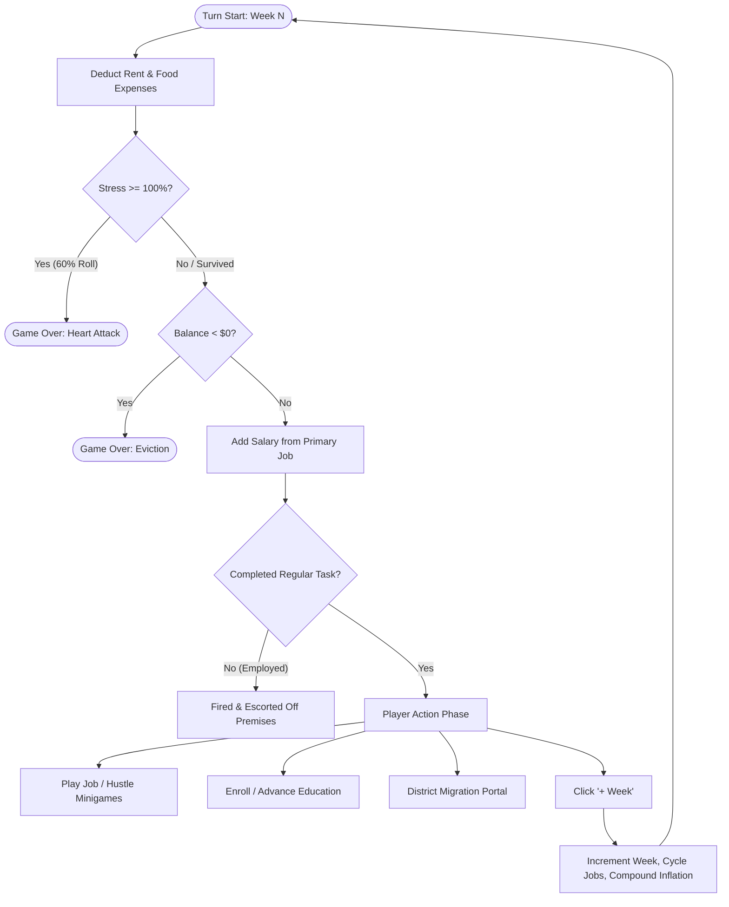
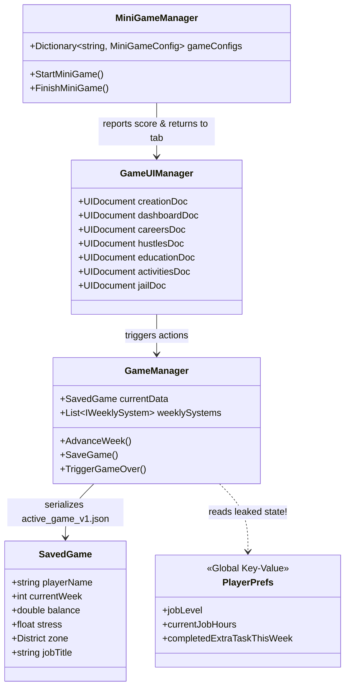

# Dear Hiring Manager: Comprehensive Project Audit & Strategic Roadmap

---

## 1. Executive Summary & Project Health

**Dear Hiring Manager** is a satirical cyberpunk corporate life-simulator built for portrait mobile devices in **Unity 6 (6000.5.4f1)** using **UI Toolkit (UIElements)**. The player navigates an unforgiving dystopian capitalist ladder—starting as a broke citizen in the Slums, scrubbing dishes and dodging debt collectors, while attempting to upskill through bootcamps and degrees to migrate through districts (Slums → Suburbs → Financial District) and ultimately reach the executive suite as a Fortune 500 CEO.

### Current Project Status
- **Reconciliation & Integrity**: Cleanly reconciled from divergent branches; all 81+ minigame task configurations, 20+ minigame controllers, career pathways, education tiers, and district migration portals are unified and operational.
- **Typography**: Complete migration from obsolete/missing Rajdhani font to high-legibility **Inter** (`Inter-SemiBold`, `Inter-Regular`, `Inter-Bold`) with zero missing glyphs or asset leaks.
- **Intro Splash Screen**: Successfully replaced the legacy 16:9 landscape 7-second video file (`StudioLogo.mp4`) with a native, portrait-first UI Toolkit splash sequence featuring the transparent **24 HOUR STUDIOS** mark, a verified **Made with Unity** badge sticker, responsive safe area padding, and instant tap-to-skip.
- **Compilation & Stability**: **0 console errors, 0 warnings** in Unity 6 Editor.

---

## 2. Core Game Loop & Economy Audit



### Critical Findings & Imbalances

#### 1. The Compounding Inflation Death Spiral (Critical P0)
- **Current Formula** ([FinancialSystem.cs](file:///c:/Users/Weari/Documents/Dear%20Hiring%20Manager%20PC/Assets/Scripts/1%20Data/Systems/FinancialSystem.cs#L74-L78)):
  ```csharp
  if (data.currentWeek % 3 == 0) {
      data.rent *= 1.12;  // +12% every 3 weeks
      data.food *= 1.10;  // +10% every 3 weeks
  }
  ```
- **The Mathematical Reality**:
  - Week 1: Rent $75 + Food $25 = **$100/wk**. Entry-level Dishwasher salary = **$120/wk** (Net: +$20).
  - Week 9: Rent $105.35 + Food $33.28 = **$138.63/wk**. Dishwasher still makes $120. (Net: **-$18.63**).
  - Week 15: Expenses exceed **$176/wk** (Net: **-$56/wk**).
  - **Verdict**: Unless a player receives exceptional RNG for promotions within the first 6 weeks, bankruptcy is mathematically guaranteed.
- **Proposed Solution**:
  - Replace raw compounding multiplication with district-pegged baseline inflation tied to the player's career tier.
  - Implement inflation caps or tie rent hikes to specific satirical News Events (e.g. *"Landlord cartel forms syndicate"*) rather than a silent clock tick.

#### 2. The Task Requirement vs Boolean Disconnect (P0)
- In [FinancialSystem.cs](file:///c:/Users/Weari/Documents/Dear%20Hiring%20Manager%20PC/Assets/Scripts/1%20Data/Systems/FinancialSystem.cs#L36-L44):
  ```csharp
  if (data.jobTitle != "Unemployed" && !manager.completedRegularTaskThisWeek) {
      // Fired: "You failed to complete your 3 required weekly tasks..."
  }
  ```
- **The Disconnect**:
  - The in-game popup text scolds the player for not completing **3 required weekly tasks**, yet `completedRegularTaskThisWeek` is a single boolean satisfied by playing **just 1** minigame!
  - Furthermore, if a player advances the week without doing a task, they are abruptly fired with zero warning prompt on the `+ Week` button.
- **Proposed Solution**:
  - Add a visual task counter to the Career card (`Tasks: 1/3` or `Shift: Fulfilled`).
  - If the player taps `+ Week` with unfulfilled job shifts, trigger a quick confirmation modal: *"Warning: Slacking off this week will result in immediate termination. Advance anyway?"*

#### 3. Sudden Death Russian Roulette at 100% Stress (P1)
- Currently, when `stress >= 1.0f`, [FinancialSystem.cs](file:///c:/Users/Weari/Documents/Dear%20Hiring%20Manager%20PC/Assets/Scripts/1%20Data/Systems/FinancialSystem.cs#L65-L72) executes:
  ```csharp
  if (UnityEngine.Random.value < 0.60f) {
      manager.TriggerGameOver("HEART ATTACK! The 100% stress crushed your cardiovascular system. You died.");
  }
  ```
- **The Issue**: A flat 60% chance of immediate permanent death creates player resentment when stress spikes from an unpreventable random event.
- **Proposed Solution**:
  - Introduce a **"Hospitalisation / ICU"** intermediary state (analogous to the Jail System): The player wakes up in the Cyber-Clinic with an emergency medical bill (e.g. $400 debt), 1 week lost, but stress reset to 60%. This retains harsh penalties without discarding a 20-week run to single-turn RNG.

#### 4. The Fortune 500 CEO Victory Trap (P0)
- In [CareerUI.cs](file:///c:/Users/Weari/Documents/Dear%20Hiring%20Manager%20PC/Assets/Scripts/3%20UI/CareerUI.cs#L479-L482):
  ```csharp
  if (job.title == "Fortune 500 CEO") {
      Debug.Log("[VICTORY] You climbed the modern corporate ladder and claimed the CEO desk. Global Overlord Victory achieved!");
  }
  ```
- **The Issue**: Reaching the final job simply writes a line to Unity console! The game does not trigger `GameManager.Instance.TriggerGameOver("VICTORY!...")`. The player remains stuck in an endless loop.
- **Proposed Solution**: Trigger the victory sequence with a custom golden victory certificate card, final score tally, and entry into the Hall of Fame.

---

## 3. Systems Architecture Audit



### 1. State Split: `SavedGame` vs `PlayerPrefs` (Critical Bug)
- **Problem**:
  - `SavedGame` is serialized cleanly to JSON in `active_game_v1.json`.
  - However, `jobLevel`, `currentJobHours`, and `completedExtraTaskThisWeek` are written to `PlayerPrefs` directly in [CareerUI.cs](file:///c:/Users/Weari/Documents/Dear%20Hiring%20Manager%20PC/Assets/Scripts/3%20UI/CareerUI.cs#L466) and [FinancialSystem.cs](file:///c:/Users/Weari/Documents/Dear%20Hiring%20Manager%20PC/Assets/Scripts/1%20Data/Systems/FinancialSystem.cs#L12).
  - When the player starts a new game after dying or wipes save data, `PlayerPrefs` keys remain! A new character starts as Unemployed but may carry over Level 4 hours multiplier ($240/wk for Dishwasher!).
- **Remedy**:
  - Move `jobLevel`, `currentJobHours`, and `completedExtraTaskThisWeek` directly into `SavedGame.cs`. Eliminate all gameplay-related `PlayerPrefs` calls.

### 2. Monolithic UI Architecture: `GameUIManager.cs` (1,483 Lines)
- **Problem**:
  - `GameUIManager.cs` manages 7 distinct `UIDocument` instances simultaneously, wires global header cards 7 times across each sub-document, manually runs string manipulation on CSS classes, and handles terminal logs, dev console, theme toggling, and CV generation in a single monolithic class.
- **Remedy**:
  - Decompose into focused presenters:
    - `TopBarPresenter.cs`: Owns name, title, cash, expenses, and district badge.
    - `NavigationPresenter.cs`: Owns tab routing and animated bottom sheet transitions.
    - `DevTerminalPresenter.cs`: Owns developer cheats and log parsing.

### 3. Minigames Engine & Input Reliability
- **Strengths**: 81 configurations covering 20+ minigames (`TimingRing`, `OrderQueue`, `PumpSystem`, `FallingSort`, `ScrubPlate`, `UnitTestRunner`, `CodeBreaker`, etc.) provide remarkable thematic variety.
- **Mobile Input Vulnerability**:
  - Minigames relying on mouse hover or rapid multi-pointer events need touch-specific deadzones and hit-target enlargements (minimum 48x48dp touch targets per Material/iOS HIG guidelines).

---

## 4. Visual Aesthetics & UI Toolkit ("Look") Audit

### 1. The Intro Screen Overhaul (Completed)
- **Before**: 16:9 landscape 7-second MP4 video letterboxed inside portrait mobile orientation; high battery consumption from video hardware decoders.
- **After**:
  - 100% native UI Toolkit splash screen.
  - Deep corporate noir-crimson radial background with subtle dither to eliminate OLED banding.
  - Centered high-resolution vector-clean **24 HOUR STUDIOS** insignia with smooth ease-out quadratic fade & scale.
  - Transparent pill-badge **Made with Unity** sticker pinned cleanly above the bottom safe area margin.
  - Tap-to-skip enabled; 2.3s total duration.

### 2. Typography & Hierarchy
- **Before**: References to missing/corrupted Rajdhani font causing UI Toolkit font asset fallback errors.
- **After**: High-DPI **Inter** font family (`SemiBold`, `Regular`, `Bold`) compiled into permanent sub-asset FontAssets. Text renders cleanly at all mobile DPIs.

### 3. Safe Area Mobile Insets (Crucial Gap)
- **Deficiency**: The UI currently stretches from `y = 0` to `y = Screen.height`.
- On modern mobile devices:
  - The top header (`Josh`, `$85.00`, hamburger menu) is obstructed by the iPhone Dynamic Island / camera notch.
  - The bottom navigation bar (`+ Week`, `Careers`, `Hustles`) overlaps the Android system navigation bar or iOS home bar.
- **Solution**:
  - Introduce a lightweight `SafeAreaHelper.cs` that inspects `Screen.safeArea` and sets `style.paddingTop` and `style.paddingBottom` on the root UI Toolkit visual containers.

### 4. Juice & Micro-Interactions
- **Deficiency**: Turn advancement is currently static. When the player taps `+ Week`, money updates abruptly and a wall of text appears in the terminal.
- **Recommended Polish**:
  - **Floating Stat Deltas**: Spawn animated floating text over the wallet (`+$120` in emerald green, `-$100` in crimson red) that floats upward and fades out.
  - **Stress Bar Pulse**: When stress enters the critical zone (>80%), animate the red fill with a slow breathing heartbeat pulse (`scale 1.0 -> 1.05`).
  - **Card Press Bounce**: Add subtle micro-scale down (`scale: 0.97`) on `PointerDown` for all buttons and cards, springing back on `PointerUp`.

---

## 5. Audio & Haptics Engine Audit (The Missing 50%)

> [!WARNING]
> Currently, the project contains **0 audio files, 0 audio components, and 0 haptic calls**. For a mobile game, audio and haptics create critical dopamine feedback loops and mechanical clarity.

### Recommended Audio Architecture (`AudioManager.cs`)

| Sound Cue | Audio Style | Trigger |
| :--- | :--- | :--- |
| **BGM: Corporate Dystopia** | Low-fi 80s dark synthwave ambient loop (80-90 BPM) | Background (continuous, ducked during minigames) |
| **Cash Inflow** | Crisp metallic mechanical register / digital credit beep | Minigame win, paycheck deposit |
| **Bill Deduction** | Dull, mechanical bureaucratic stamp / pneumatic thud | Weekly rent/food deduction |
| **Turn Advance** | Electric camera shutter / digital page turn | Tapping `+ Week` |
| **Critical Stress Pulse** | Muffled biological heartbeat (increasing BPM with stress) | Stress > 75% |
| **Arrest / Police Raid** | Distant sirens + metallic cell door slam | Illegal hustle bust |
| **Minigame Hit / Miss** | Sharp click for success, digital static glitch for error | Minigame interactions |

### Recommended Mobile Haptic Profile
- **Light Impact**: Tab switching, card browsing, minigame button taps (`HapticFeedback.Light`).
- **Medium Impact**: Completing a minigame, receiving a promotion (`HapticFeedback.Medium`).
- **Heavy Warning Pulse**: Stress > 90%, receiving an eviction notice, getting arrested (`HapticFeedback.Heavy`).

---

## 6. Strategic Implementation Roadmap

```mermaid
graph LR
    subgraph Phase 1: Core Balance & Stability
        P0_1[Clean PlayerPrefs into SavedGame] --> P0_2[Tame Inflation Curve]
        P0_2 --> P0_3[Fix CEO Victory Trigger]
        P0_3 --> P0_4[Implement SafeArea Insets]
    end
    subgraph Phase 2: Audio, Haptics & Juice
        P1_1[Implement Sound & Haptic Manager] --> P1_2[Floating Cash & Stress FX]
        P1_2 --> P1_3[Job Shift Fulfilled Warning]
    end
    subgraph Phase 3: Content & Mobile Release
        P2_1[Hospitalisation ICU Rework] --> P2_2[Google Play & App Store Packaging]
    end
    Phase 1 --> Phase 2 --> Phase 3
```

### Phase 1: Core Balance, Stability & Safe Area (P0 - Immediate)
1. **Migrate PlayerPrefs to `SavedGame.cs`**:
   - Move `jobLevel`, `currentJobHours`, and `completedExtraTaskThisWeek` into `SavedGame`.
   - Ensure clean save wipes on death/restart.
2. **Rebalance the Economy**:
   - Replace the runaway `1.12^N` exponential inflation in `FinancialSystem.cs` with district-governed flat rate adjustments.
   - Adjust entry-level Dishwasher and Trainee wage scales to allow strategic saving.
3. **Trigger CEO Victory Sequence**:
   - Wire `job.title == "Fortune 500 CEO"` to `GameManager.Instance.TriggerGameOver("VICTORY!...")`.
4. **Implement Mobile `SafeAreaHelper`**:
   - Automatically adapt UI Toolkit containers to hardware notches, Dynamic Islands, and navigation pills.

### Phase 2: Audio, Haptics & Visual Juice (P1 - High Value)
1. **Integrate Minimalist Sound & Haptic Manager**:
   - Synthesize or import royalty-free cyber-corporate UI audio cues.
   - Implement Android/iOS haptic feedback triggers for button taps and weekly ticks.
2. **Turn Advancement Animation & Stat Deltas**:
   - Floating green/red cash deltas (`+$120.00`, `-$100.00`).
   - Smooth easing on the progress bars (Performance, Job Luck, Stress).
3. **Turn Warning Confirmation**:
   - Warn player if advancing week without fulfilling their required work shifts.

### Phase 3: Systems Architecture & Polish (P2 - Long-Term)
1. **ICU / Cyber-Clinic System**:
   - Replace sudden 60% heart-attack death with a brutal hospitalisation bill and 1-week recovery.
2. **Decompose `GameUIManager.cs`**:
   - Split top bar, footer navigation, and dev console into modular components.
3. **Mobile Build Pipeline**:
   - Configure Android App Bundle (AAB) & iOS Xcode export settings with targeted 60 FPS frame pacing.
