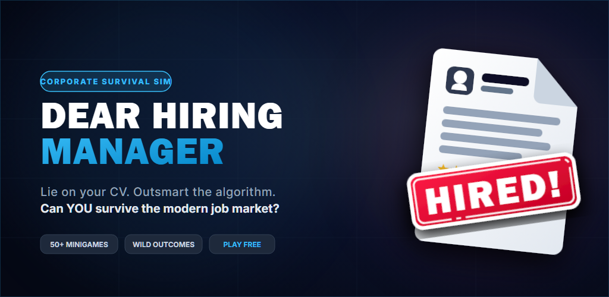
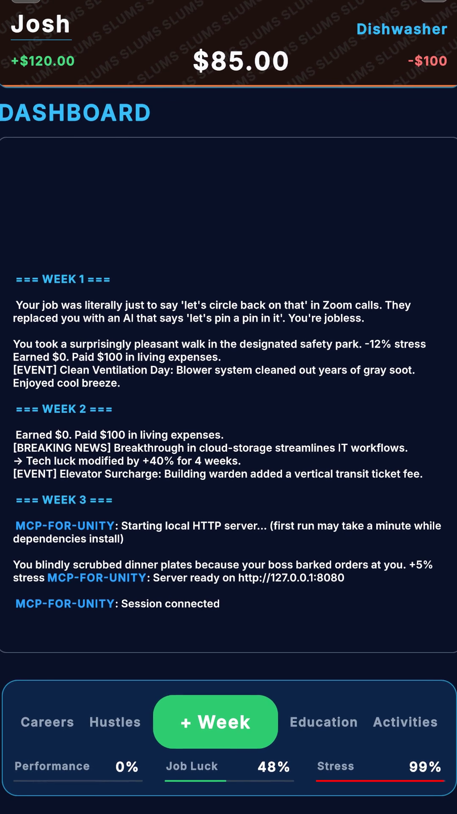
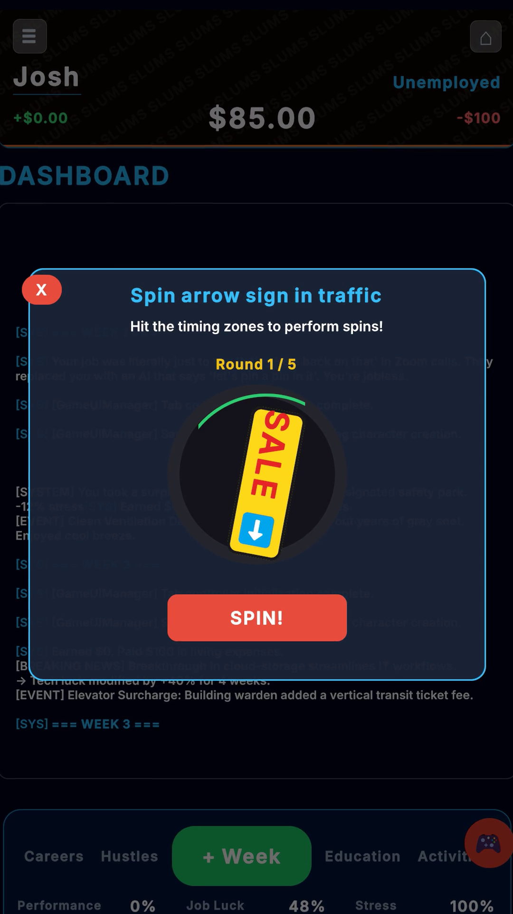
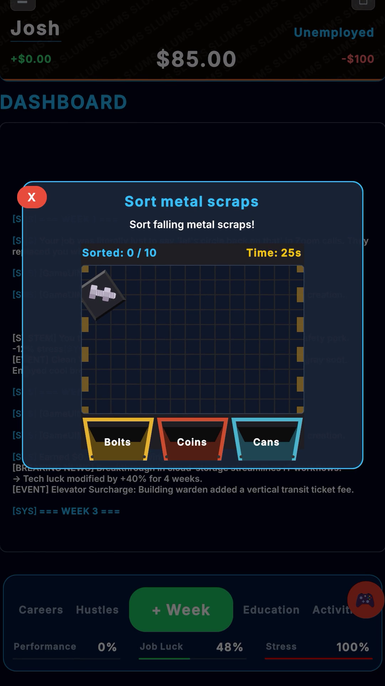
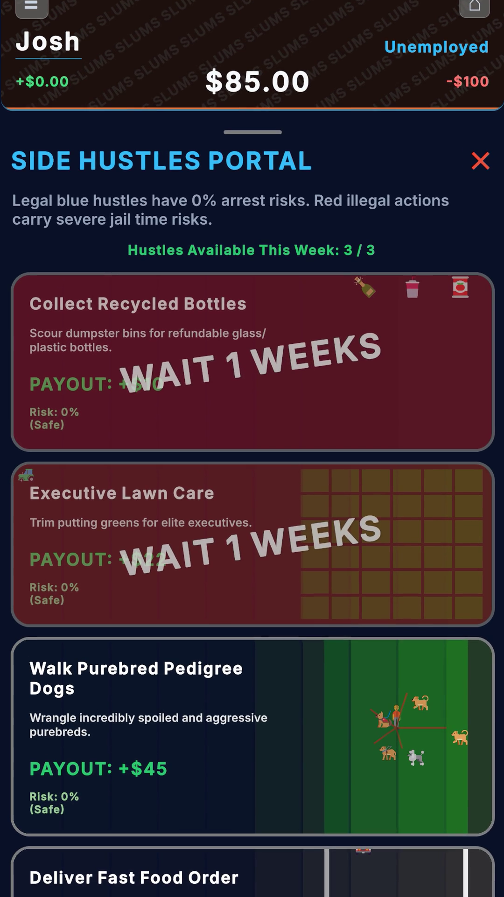

# Dear, Hiring Manager 🏢💼⚡
### *A Satirical Cyberpunk Corporate Life-Simulator*

[](https://unity.com/)
[](https://github.com/JoshUEL2/DearHiringManager/releases)
[](https://docs.unity3d.com/6000.0/Documentation/Manual/UIElements.html)
[]()
[](https://joshej.itch.io/dear-hiring-manager)



---

## 🎯 Executive Overview

**Dear, Hiring Manager** is a high-octane, portrait-first satirical corporate life-simulator built in **Unity 6 (6000.5.4f1)** using **UI Toolkit (UIElements)**. 

The player enters an unforgiving dystopian capitalist treadmill—starting completely broke in the Slums with **$0**, scrubbing dishes, sorting trash, and dodging relentless debt collectors. By balancing brutal weekly shifts, enrolling in technical bootcamps, managing cardiovascular stress thresholds, and risking it all on underground side hustles, the player must migrate through districts (**Slums → Suburbs → Financial District**) and conquer the boardroom as a **Fortune 500 CEO**.

> *"In the corporate machine, you're not an employee. You're an expendable sub-routine."*

---

## 📱 Gameplay Showcases & Screenshots

<p align="center">
  
  
  
  
</p>

### 🎬 Trailers & Video Showcases
- **Official Gameplay Trailer (16:9 4K/60)**: `Marketing/Trailers/Official_Gameplay_Trailer_16x9.mp4`
- **TikTok / Reels / YouTube Shorts Ad (9:16 Portrait)**: `Marketing/Trailers/Official_Shorts_Reels_Ad_9x16.mp4`
- **Vertical Teaser**: `Marketing/Trailers/Trailer_Teaser_Vertical_1080x1920.mp4`

---

## ⚙️ Key Systems & Architectural Features

### 1. 20+ Interactive Minigames & 81+ Procedural Shifts
- **Subpixel Physics & Pointer Capture**: Custom UI Toolkit pointer-driven interactions engineered for 60-120Hz mobile touchscreens.
- **Minigame Archetypes**:
  - 🔄 **Timing Rings**: High-precision rotary inspection and electrical repair.
  - 🧊 **Falling Sorters**: Categorize falling components, frozen goods, and office documents into sorting bins under strict timers.
  - 🏃 **Agile Scrums**: Rapid multi-choice standup triage and sprint point balancing.
  - 🚗 **Grid Steer & Courier Delivery**: Drag-and-drop courier routing avoiding roadblocks and potholes.
  - 📑 **Ledger Auditing & Tax Stamping**: Stamp approvals, verify balance sheets, and dodge compliance fines.
  - 💻 **Syntax Debugger**: Real-time code review minigame fixing broken unit tests.

### 2. Dystopian Economic Simulation & Compounding Inflation
- **Weekly Balance Sheet**: Rent, food, utilities, and tax withholding deducted automatically each week.
- **Compounding Inflation**: Rent increases dynamically, forcing players to continually upskill or succumb to eviction.
- **Underground Side Hustles**: High-risk, high-reward hustles (illegal crypto staking, dog walking, scrap trading) with custom RNG raid/bust calculations.
- **Cardiovascular Stress Thresholds**: Stress accumulates with overtime shifts and missed deadlines. Exceeding 100% risks cardiac arrest and cyber-clinic ICU debt.

### 3. District Migration & Education Progression
- **Three Unique Districts**:
  - 🏚️ **Slums**: Dishwasher, Janitor, Line Cook, Fast Food Courier.
  - 🏙️ **Suburbs**: Junior Developer, QA Analyst, Data Entry Specialist, Office Clerk.
  - 💎 **Financial District**: Senior Architect, Hedge Fund Quant, VP of Operations, Fortune 500 CEO.
- **Education Ladder**: Bootcamps, Associate Degrees, BSc Computer Science, MBA, and Executive Certifications required for promotion eligibility.

### 4. Dynamic UI Toolkit Architecture & Themes
- **Native UIElements / USS**: Zero canvas overhead, vector-sharp typography powered by Inter font assets.
- **Tri-Theme Engine**:
  - 🔴 **Default (Obsidian-Crimson)**: Cyberpunk noir with crimson neon accents.
  - 🌙 **Dark Mode**: Sleek low-contrast charcoal for night sessions.
  - ☀️ **Light Mode**: Clean minimalist paper aesthetic.
- **Adaptive Safe Area**: Real-time notch, dynamic island, and gesture-bar padding detection.

### 5. Adaptive Audio Engine & SFX Palette
- **Lo-Fi BGM Jukebox**: Curated lo-fi hip-hop and ambient corporate elevator synth loops.
- **Hundreds of Tactile SFX**: Procedurally generated and tactile audio triggers for every button press, stamp, register ring, dog bark, keyboard clack, and heart monitor beep.

---

## 📦 Android Installation (APK Sideloading)

1. Download the latest release APK from [GitHub Releases](https://github.com/JoshUEL2/DearHiringManager/releases) or [itch.io](https://joshej.itch.io/dear-hiring-manager).
2. On your Android phone, enable **"Install unknown apps"** in *Settings > Security*.
3. Tap `DearHiringManager.apk` in your device's Downloads folder to install.
4. Launch and conquer the corporate ladder!

---

## 🛠️ Automated Publishing & Build Pipeline

To build and push game updates seamlessly across platforms, run the automated publisher:

```powershell
# Build Android APK and publish release to GitHub & Itch.io
.\publish_game.ps1 -Version "1.0.0"
```

Options:
- `-Version <string>`: Release version tag (e.g. `1.0.0`, `1.1.0`)
- `-BuildOnly`: Only build the ARM64 release APK without publishing
- `-PushGitHub`: Create a GitHub release and push tags
- `-PushItch`: Upload and publish the new build to itch.io via Butler
- `-DryRun`: Validate environment, toolchains, and files without modifying remotes

---

## 📖 Comprehensive Game Dossier & Design Documentation

For the complete 260+ line technical breakdown, economic formulas, game balance post-mortem, and long-term design roadmap, inspect:
📄 **[DHMP Comprehensive Audit & Strategic Roadmap](Docs/DHMP_Comprehensive_Audit_And_Roadmap.md)**

---

## 👤 Credits & Author

- **Game Design & Systems Engineering**: Joshua Johnson ([LinkedIn](https://www.linkedin.com/in/joshua-johnson-485543351/) | [Portfolio](https://joshej.itch.io/))
- **Engine**: Unity 6000.5.4f1
- **Studio**: 24 Hour Studios
